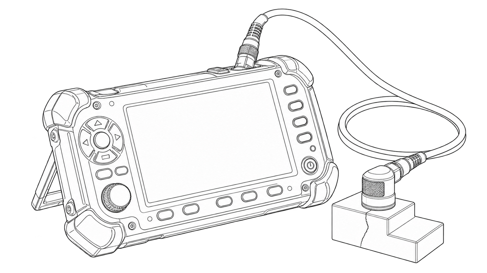
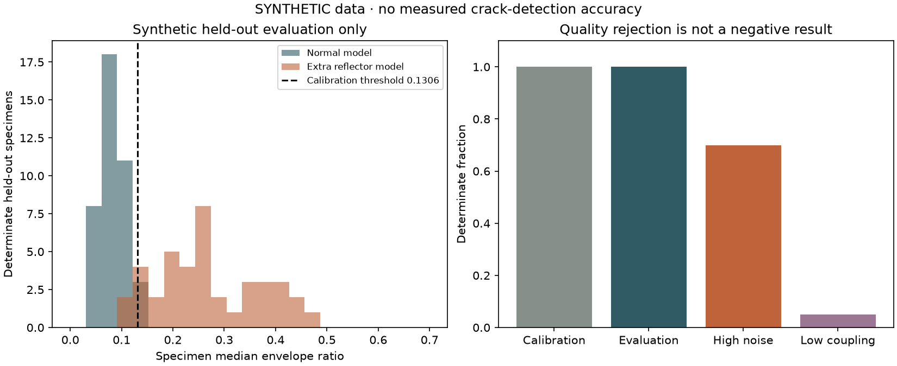

# Ultrasonic Crack Detection in 3D Prints



*Generated line-art concept illustration.*

An offline pulse-echo signal lab with a reproducible synthetic experiment, real signal-processing code, a bounded CSV acquisition-file interface, and actual waveform/comparison figures. It separates valid indication scores from indeterminate captures and keeps calibration specimens separate from held-out specimens.

**This release has no measured physical crack-detection accuracy or tested hardware integration.** The default data are generated Gaussian-carrier signals with an optional extra reflector. They are not scans of printed parts or a validated crack simulation. The single-file adapter does not apply a synthetic threshold to measured data.

## Run

Use Python 3.12 or 3.13. No account, network service, external dataset, or instrument is needed after installation.

```sh
python -m venv .venv
# macOS / Linux
source .venv/bin/activate
# Windows PowerShell: .venv\Scripts\Activate.ps1
python -m pip install -r requirements-benchmark.txt
python -m pip install --no-deps -e .
ultrasonic-lab benchmark --output artifacts/study
```

Open `artifacts/study/index.html` in your browser. The static report uses relative local figures and makes no network requests. A recorded run is also included in [demo/index.html](demo/index.html). Existing output directories are never overwritten.

## What the code does

1. Validate seconds/volts CSV data, uniform sampling, frequency support, time gates, and bounded metadata/settings.
2. Apply an offline Butterworth band-pass using SciPy second-order sections, then compute the Hilbert envelope.
3. Reject clipping or a weak reference backwall as **indeterminate**. Compute the accepted indication-gate peak / backwall-gate peak ratio.
4. Generate 184 synthetic specimens with three repeated captures each. Fit a fixed 95th-percentile threshold on the 64 normal calibration specimens only.
5. Evaluate 80 separate held-out specimens and separate noise/coupling stress groups. Report class counts, accepted-only denominators, and quality exclusions together.
6. Export actual Matplotlib figures, raw numeric synthetic arrays, individual capture/specimen results, source/config/data hashes, and a readable HTML report.

The score depends on the reference echo, coupling, attenuation, gates, and noise. It is not a probability. Forward/backward filtering and Hilbert processing use future samples, so this is an offline workflow. A weak backwall can occur in a damaged or attenuating specimen: quality rejection is not proof of a sound part.

The simulator's velocity, thickness, and waveform parameters are explicit illustrative assumptions. No PLA velocity, flaw size, physical sensitivity, or standards compliance is inferred. See [method and limitations](docs/method.md) and [synthetic data](docs/synthetic-data.md).

## Recorded synthetic results



The frozen threshold is **0.1305835819**, fitted from 64 normal calibration specimens. No test or stress results were used to choose it. All three repeats stay with their specimen.

| Group | Determinate / total specimens | TP / FN | FP / TN | Accepted-only interpretation |
| --- | ---: | ---: | ---: | --- |
| Normal calibration, fitting set | 64 / 64 | 0 / 0 | 3 / 61 | FPR 3/64; sensitivity undefined |
| Held-out synthetic evaluation | 80 / 80 | 37 / 3 | 2 / 38 | Sensitivity 37/40; FPR 2/40 |
| High-noise stress | 14 / 20 | 7 / 0 | 7 / 0 | **Every accepted normal specimen is falsely flagged (7/7)** |
| Low-coupling stress | 1 / 20 | 1 / 0 | 0 / 0 | **19/20 indeterminate**; no accepted normal denominator |

The noise result is a clear failure, and the coupling result has too little usable coverage to establish useful performance. They remain visible in the report. Overall, 77 of 552 captures were rejected. These rates describe only the specified synthetic generator, with no measured crack-accuracy or generalization claim. See [metrics](demo/metrics.json), [individual specimens](demo/specimens.json), and [capture-level quality/results](demo/captures.json).

## Analyze an exported capture

```sh
ultrasonic-lab analyze --trace capture.csv --metadata capture.json --settings settings.json --output artifacts/capture-01
```

CSV must start with `time_s,amplitude_v`. Metadata must state `source_kind: "measured_unverified"` for an operator-supplied measured file. Unknown velocity stays unknown; supplying velocity requires a note about its basis and produces only an apparent peak depth. The output gives quality status and a ratio, with **no physical crack decision**.

See the complete [file/command contract](docs/contract.md) and [acquisition guide](docs/acquisition.md). The guide describes instrument roles and pending calibration checks. There is no untested serial driver or pulser circuit in this package.

## Verification and development

```sh
python -m ruff check src tests tools
python -m ruff format --check src tests tools
python -m pytest --cov=ultrasonic_lab --cov-branch --cov-report=term-missing --cov-fail-under=85
python -m build --no-isolation
python tools/check_wheel.py dist/*.whl
```

The wheel check installs into a new temporary location, starts outside this source tree, blocks external connection creation, runs the complete benchmark and CSV adapter, and checks the actual figures/report. CI runs Python 3.12/3.13 on Linux, macOS, and Windows. See [verification](docs/verification.md) for the actual local results, versions, hashes, and limits.

Contributions must preserve specimen-level separation and report rejected captures. See [CONTRIBUTING.md](CONTRIBUTING.md), [SECURITY.md](SECURITY.md), and [CHANGELOG.md](CHANGELOG.md).

## History and rights

This implementation was built in October 2026. The previous unrelated cartoonifier/notebook content remains in [archive/before-ultrasonic-crack-detection-2026-10-27](https://github.com/ungaaaabungaaa/ultrasonic-crack-detection/tree/archive/before-ultrasonic-crack-detection-2026-10-27). No legacy code was reused and the old tree had no license file. Existing repository dates and stars do not establish the date of this new work.

New code, generated synthetic examples, and result figures are [MIT licensed](LICENSE). The README cover is an approved generated concept, with [provenance](docs/images/cover-provenance.json); it is not hardware or inspection evidence. The portfolio site is unchanged.
