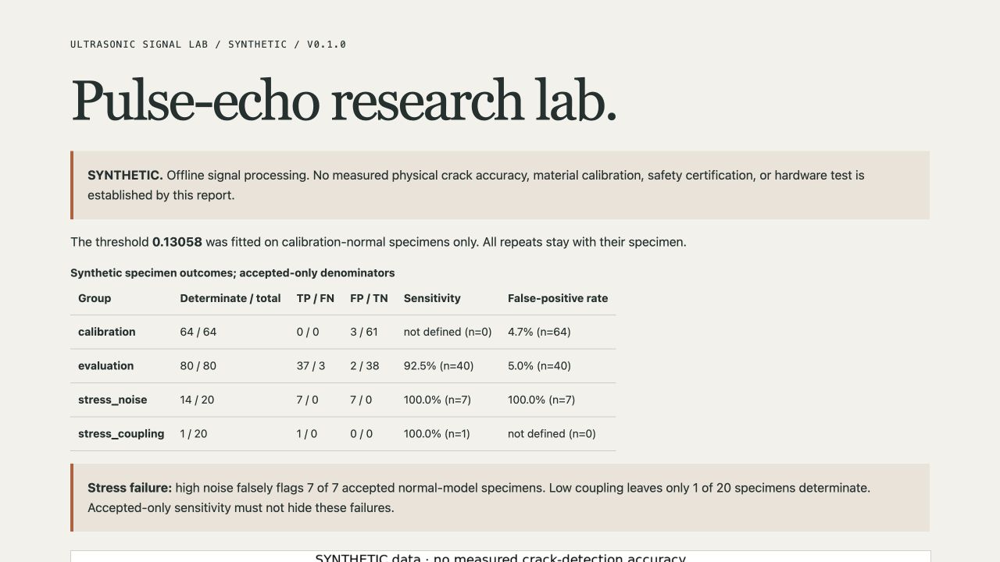

# Verification — 27 October 2026

Local runtime: macOS, Python 3.12.14, NumPy 2.3.5, SciPy 1.18.1, and Matplotlib 3.11.2. Exact runtime and development dependencies are in `requirements-benchmark.txt`. No physical instrument or measured specimen was used.

## Checks run

- **16 Python tests passed**, with **95.41% combined line/branch coverage**. Tests cover known echo timing and ratio, apparent pulse-echo depth, finite envelopes, clipping and weak-backwall indeterminates, malformed/oversized CSV, units, sampling/gate limits, metadata/settings bounds, symlink/FIFO rejection, specimen grouping, strict threshold equality, calibration-only fitting, explicit missing-result denominators, reproducible independent specimen streams, the full synthetic workflow, no overwrite, and CLI failure behavior. The symlink/FIFO fixture skips on Windows because symlink creation requires developer privileges.
- The declared `measured_unverified` import path was exercised through the CLI with a **generated voltage fixture**, not a real scan. The result kept unknown velocity/depth null, made no crack decision, preserved the unverified source declaration, and recorded the exact parsed input hashes.
- Ruff lint and format checks pass for `src`, `tests`, and `tools`. Python module compilation and Git whitespace checks pass.
- `tools/verify_recorded.py` verifies the recorded data hash, safe numeric array shape, all 552 generated signals against their saved arrays, capture identities, quality results, scores, specimen aggregation, calibration threshold, all group counts, source digest, and settings digest. Cross-platform floating-point comparisons use explicit tight tolerances; bit-for-bit regenerated waveforms across native math libraries are not claimed. The saved file's exact byte hash is always checked.
- Built the wheel and source distribution, then ran `tools/check_wheel.py`. It installed the wheel with no index/dependency resolution into a temporary target, started outside the source checkout, asserted the import came from that target, blocked external connection creation, ran the complete benchmark and single-file adapter, verified actual figures/report, and checked CLI version output. All passed. No runtime application assets are missing; the package needs only its Python code and declared scientific dependencies.

The six CI jobs cover Python 3.12/3.13 on Linux, macOS, and Windows. Use the actual pull-request checks for their status; this record reports the local checks separately. Text files have fixed LF checkout attributes so byte/source hashes remain valid on Windows.

## Frozen results and provenance

The source digest for the recorded run is:

`87fe8754e1fd8ff36676a6a09a4881b375ca45f2c5090bd7557d2ad7d6caa2e1`

The numeric synthetic archive SHA256 is:

`a6e70ad9612e64ab3f011af2e9cfb6c59b4bf4ba151e4af61a35378236b44fa7`

Settings SHA256, using sorted-key JSON, is:

`9d7577a9ec6686306fddbb5424c2ce6920daacb3841a5305e9c687793c4a374f`

The threshold is 0.13058358190783736, fitted only from 64 normal calibration specimen medians. Held-out synthetic results are TP 37, FN 3, FP 2, TN 38, with all 80 specimens determinate. High-noise stress leaves 14/20 determinate and falsely flags all seven accepted normal specimens. Low coupling leaves only 1/20 determinate. These failure cases are retained prominently. There are 77 rejected captures out of 552. No parameters were tuned after this first frozen result to improve those figures.

## Visual checks

The actual score-distribution and quality-coverage figure was inspected. The static report loaded in the in-app browser, displaying the synthetic source label, calibration-only threshold, all four groups and denominators, a prominent stress-failure notice, and actual figures. Expanding the quality/provenance section exposed the current source digest and quality rules. The local figures and JSON links loaded; no external service is used.

The screenshot shows computed synthetic results. The separate README cover is an approved generated concept. A specific mobile viewport has not been independently tested in this record.

## History and remaining limits

The original repository main `f4b760cbf654f05f9340a9581eead306998eade9` was archived remotely before replacement. The approved rename retained ID `R_kgDOIZVOqQ` and 17 stars. The old unrelated code had no license and was not reused. The portfolio source was not changed.

Physical assembly, electrical-interface checks, actual instrument acquisition, specimen-specific velocity/zero/reference calibration, independently labeled measured cracks, and held-out physical validation remain pending. The synthetic generator and score do not establish crack size, certified inspection, physical accuracy, or a calibrated probability.
